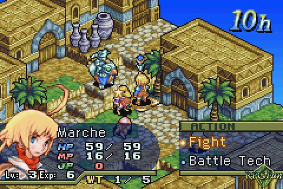
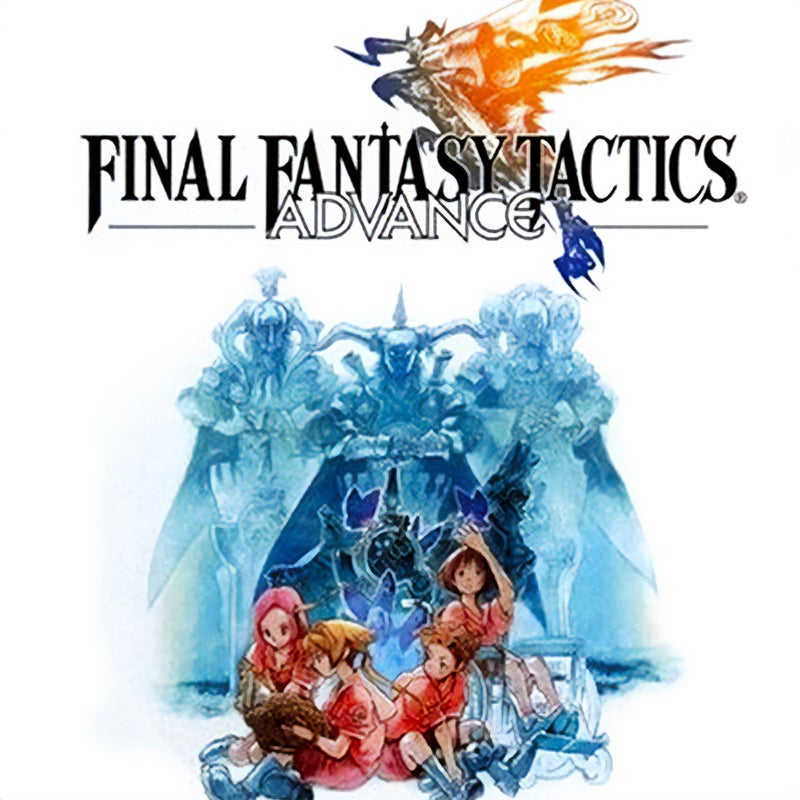
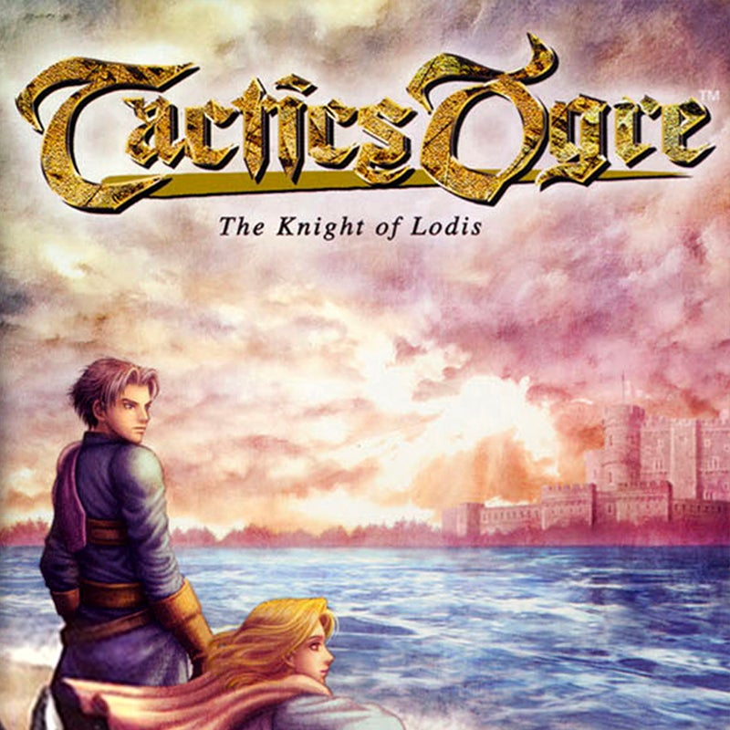
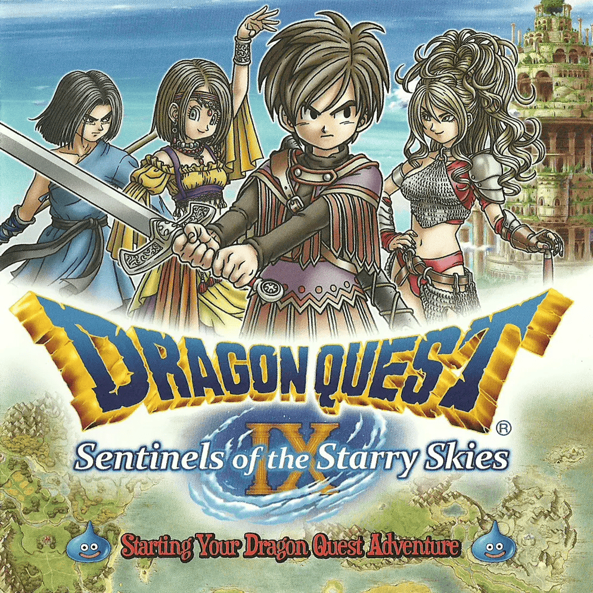
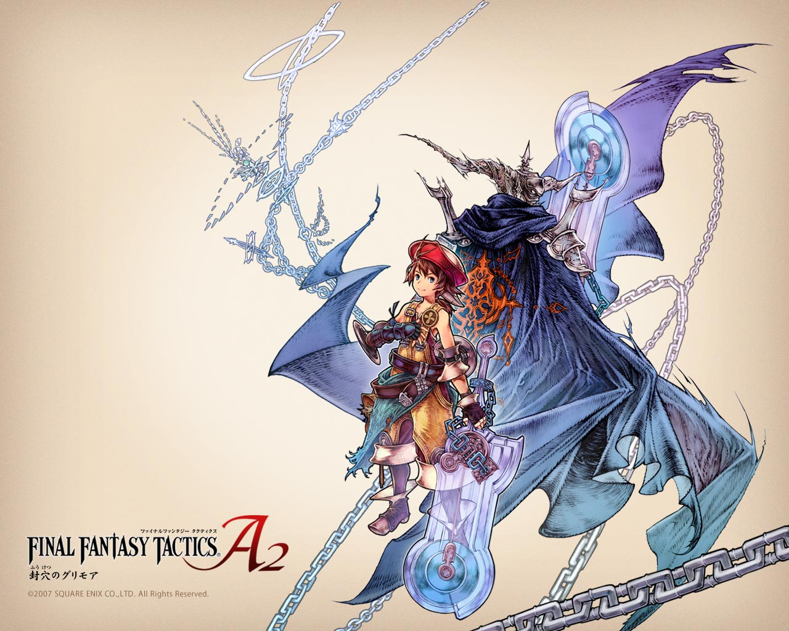
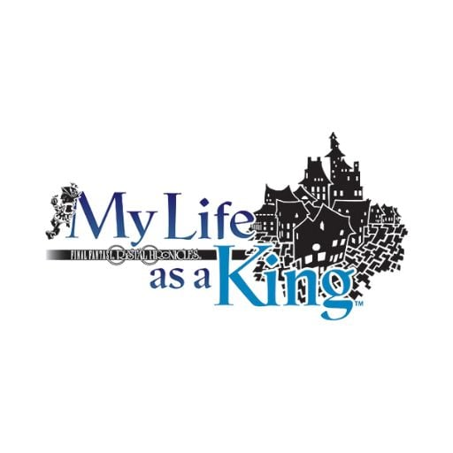
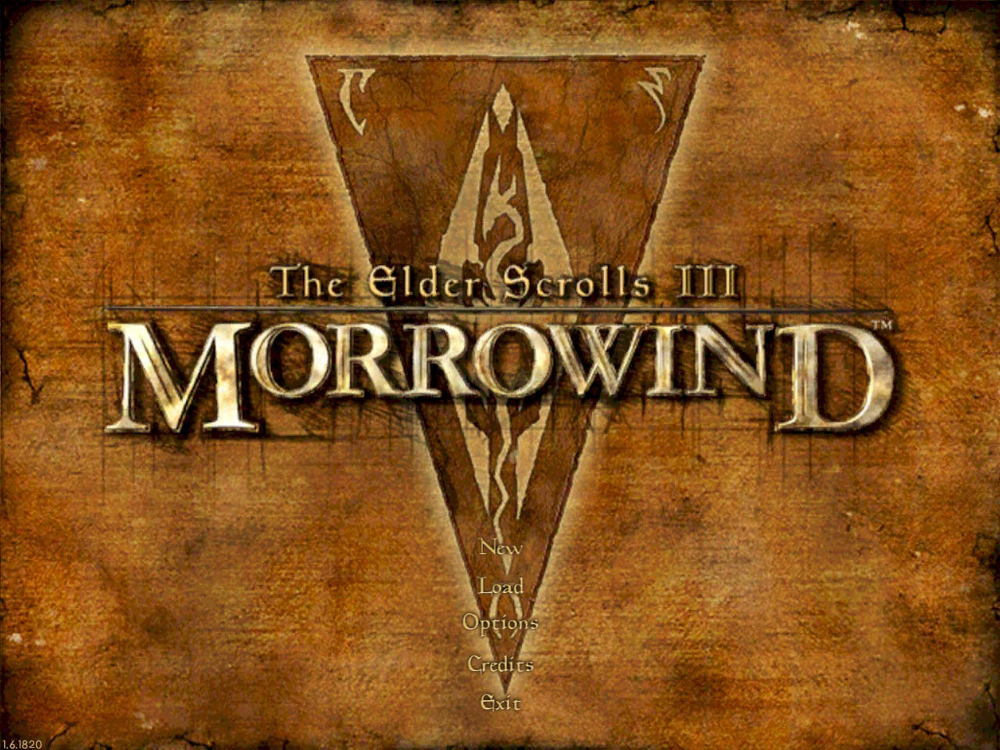
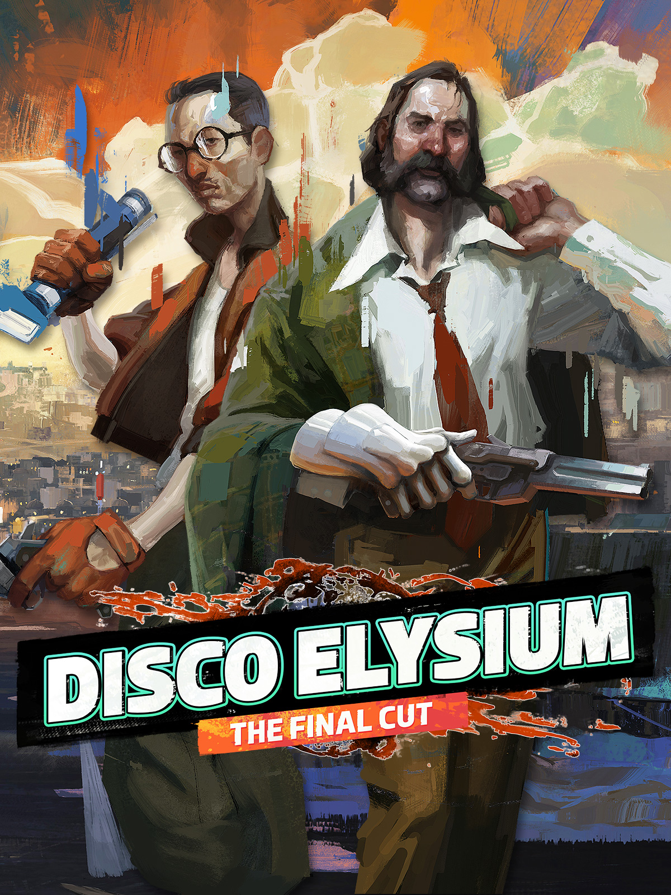

## Introduction

At the time of writing, I have actually been working on and off (almost always "off", though) for about a year on a JRPG. This post will serve as an introduction to the game, including some of its inspirations, art directions I envision, themes, etc., as a broad-strokes overview of what I'm trying to do. It should also serve as a useful reminder to me, the next time I spend a few months without touching the game, since every time I do this, I feel like I need to re-learn and -familairize myself with the codebase and whatever I was last working on. 

I will make another post, Devlog 01, which will explain some of the core systems and features I've developed so far–a class system, abilities, damage calculations and formulae, buffs and debuffs, etc. Thereafter, Devlog posts will be more sporadic (reflecting my approach to working on this project), and will be about what I'm currently working on, contrasting the retrospective nature of the first two posts.

## Overview

The working title I have for the game is **Strands of Fate**, but this is extremely subject to change–nonetheless, I'll refer to the game as *Strands of Fate*, or *SoF*, or SoF hereafter. At its core, SoF is a JRPG with a *Final Fantasy*-like combat system. This means that combat is turn-based and takes place on an isometric-rendered 2D grid representing the map, and controls about 6 units that do battle against the opponent, which can range from 1 unit (e.g., a boss battle) to 8-10 units (a more standard fight). A typical scene one might expect is:

Generically, a unit's turn consists of two stages: movement, where they choose a location on the map to move to: how far they can move depends on the terrain, and the unit itself (a nimble rogue can move farther than an overencumbered knight). Once they move, they can take an action, which could include attacking another unit within their attack range, casting a spell of some sort, using an item, etc.

The player's units persist from battle to battle, can level up, change classes, etc. The unit's class determines what spells it has access to, and how much each of its attributes increases per level-up. A key design choice that I made is that **unit death is permanent**! Any unit not revived by the end of combat is lost forever. This increases the stakes of combat, and also aligns with some of the other themes/feelings that I want to emphasize: one is that the player's units should feel like a *team* of individuals, who change and evolve over time, sometimes reacting to story events–each unit should feel, if not special, at least *individualized* in some way, and that means that no unit is easily replaceable!

## Inspirations
This list is not exhaustive, as we are constantly being inspired by the things around us... but in terms of explicit inspirations (I'll also limit this to only video game titles), in no particular order:

### Final Fantasy Tactics Advance 

The first JRPG I ever played, which no doubt ignited my love for the genre. We've all wanted to escape to a fantastical world where we could be everything we aren't.

{.inspo-img}

### Tactics Ogre: The Knight of Lodis 

Iconic GBA title. The first game I played with perma-death, and has multiple branching storylines depending on choices the player makes–both of these inform some game design decisions I've made myself. Also, I really love the feeling of the game: biblical, gothic, a bit darker than a lot of other JRPGs.

{.inspo-img}

### Dragon Quest IX: Sentinels of the Starry Skies

Almost surely the game I have the most hours in, of all time. The first (and only! But I plan to change this, hopefully) **Dragon Quest** game I've played. Different combat system as there is no movement, but overall an amazing game with an incredible amount of post-game content. Probably >97% of my hours was spent after beating the final boss. I'll never forget when I first figured out how to use the [Hoimi Table](https://www.woodus.com/den/games/dq9ds/hoimi_table.php) to exploit DQIX's psueorng in elementary school.

{.inspo-img}

### Final Fantasy Tactics Advance 2: Grimoire of the Rift

Probably my second favourite DS JRPG of all time, after DQIX. One of the most amazing video game soundtracks ever, to me, and also I think did a good job of expanding on (and improving in some ways!) the class system from FFT and FFTA. Introduced lots of cool classes and had quite solid post-game content.

{.inspo-img}

### Final Fantasy Crystal Chronicles: My Life as a King

Absolutely lovely WiiWare title, and quite different from the other games on the list. This was actually the initial inspiration for SoF–I wanted to make essentially a more in-depth/complex version of MLaK, which is essentially a simulation/party-management game. My idea for SoF ended up evolving further beyond this to a more traditional JRPG, but there are certainly still significant elements of MLaK to be found.

{.inspo-img}

### The Elder Scrolls III: Morrowind

Another non-JRPG, and in fact the first non-J game on this list. My favourite entry in **The Elder Scrolls**, though I've played it much less than I have **Skyrim**. This game is an absolute masterclass in writing and atmosphere, and has truly quirky, wonderful, and deep gameplay design.

{.inspo-img}

### Disco Elysium 

Another non-JRPG, and one of my favourite games of all time. I felt so inspired by the writing, and the very overt poltiical themes are something I wanted to bring into a different setting with SoF. This game somewhat inspired one concept I'm still sort of hashing out, which is essentially that certain player choices have affects on party members depending on the party members' political disposition, or something along those lines; still working out the implementation details.

{.inspo-img}

## Themes

Once these are more fleshed out, I will likely write a devlog for each, to examine how each theme is explored from a storywriting and game design standpoint.

### Time and Regret

- What's done is done; we can't change what happened in the past, and we can't go back to the past ([or can we?](https://arxiv.org/pdf/1505.01125)).
- Regret is a natural feeling in life–the simple desire to "turn back the clock" and been able to have done differently. Accepting and reckoning with this feeling is a crucial part of life.
- Antagonists will be bound by regret: regret about things they did in the past, or about the way certain events unfolded; this will be reflected in their abilities having power over the chronology, for instance the ability to reset the game state to a previous turn, etc. Other antagonists are obsessed with the past in a different way–reactionary and conservative politics. In either case, they are characterized by a non-forward-thinking mindset.

### Revolutionary Politics

- "the true revolutionary is guided by great feelings of love" - Che Guevara. SoF is explicitly political, and I will not hide the fact that my political leanings are quite far left. 
- Choices the player makes will have affects on the world, how they are treated, and even how their own party members "feel" towards them, depending on the person–revolutionaries will feel embolded by the player who takes "revolutionary" action, while conservatives will be reassured by players who tend in that direction. These choices may also affect what items, recruitable units, battles, and cutscenes are available on a given playthrough.
- Ultimately, the story is about the triumph of the revolutionary spirit.

### Agency
- The choices we make matter–decisions are the thing that life is made of.
- Choices are not reversible: once units die, they die; once a choice has been made, it can't be taken back, and sometimes this will permanently close certain doors (while opening others!). For instance, a player who early on sides with the regressive old-world church (hypothetical) may not see a later cutscene involving an anti-theist revolutionary leader, thus losing access to parts of the story behind that wall.
