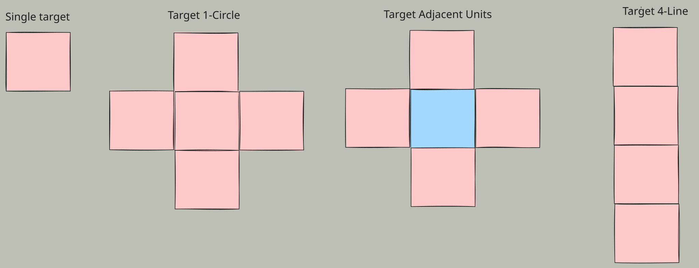
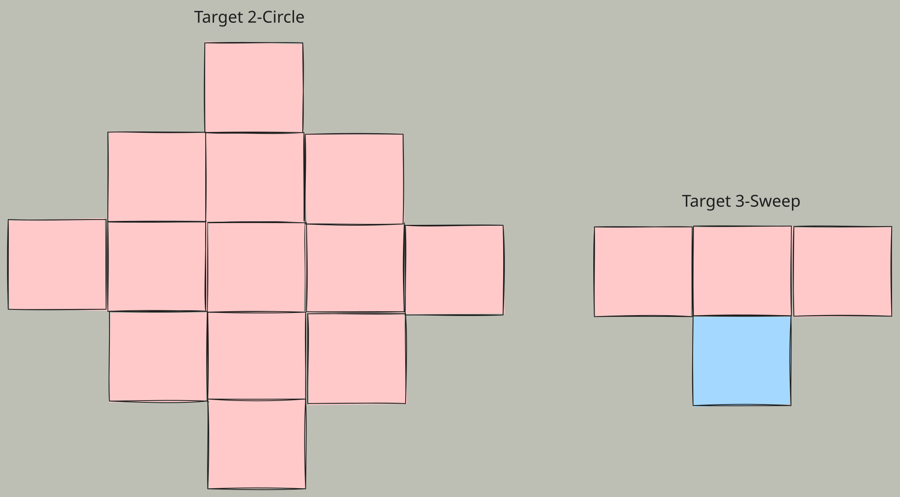

## Introduction

In this blog post, I'll explain a bit about `Actions`, since they are the fundamental *thing* that each unit does.

## (Basic) Attack

The simplest thing a unit can do: attack another unit with their equipped weapon. This costs `0 mp` and can always be done, provided there is a target in range and the unit is not afflicted with a [Crowd Control](#crowd-control) effect that blocks attacks (e.g. `Stun` or `Petrify`).

An `Attack` almost always does physical damage to a single target; `Jobs` that are oriented towards dealing physical damage often derive most of their damage from `Attacks`. Generally speaking, an `Attack` has about a $95\%$ probability of hitting.

## Skills

Basically, "everything else" a unit can do. This could be casting a spell of some sort, for instance `Heal` or `Fire`, or using an ability (which is essentially the same as a spell, just without magical connotations) such as `Disarm`. `Skills` usually cost `MP` to cast, though a select few may cost `HP`. They are much more varied in terms of their AoE, which could be (non-exhaustive): single-target, target $1$-circle, target adjacent units, target $4$-line, etc. In the following diagram, the pink tiles represent the AoE, and blue tiles represent the unit's location.

Other, slightly more exotic AoE types include a $2$-Circle and $3$-Sweep:

`Skills` are broadly split by their function, which can be summarized as follows.

### Damage Skills

A skill whose primary purpose is to deal damage. If the `Skill` is magical in nature, then its damage is computed based on the `MATK` of the attacker and `MDEF` of the defender: these are *derived stats* which depend on the attributes of the attacker and defender: more details can be found in (LINK TO DEVLOG 03).

There also is a small subset of `DamageSkills` whose damage is computed directly using the underlying `Attributes` (e.g. `STR` or `INT`) of the caster, but such cases are rare.

### Heals

A skill to restore the `HP` or (rarer) `MP` of an ally: fairly straightforward. The effectiveness of the `Heal` is primarily determined by the unit's `WSM`.

### Status Effects

A large class of `Skills` unto itself, a `StatusEffect` is anything that, broadly speaking, changes the *state* that a unit finds itself in: perhaps by temporarily increasing or decreasing a certain stat, forbidding certain types of actions, or applying damage each time the unit takes a turn (e.g. `Poison`).

#### Buffs

A `StatusEffect` that temporarily increases one or more of the target's stats, for instance a spell that temporarily increases the target's `TGH` for $3$ turns.

#### Debuffs

A `StatusEffect` that temporarily decreases one or more of the target's stats, for instance a spell that temporarily decreases the target's `STR` for $3$ turns.

#### Crowd Control

A `Skill` that applies a `StatusEffect` that temporarily prevents the target from taking certain types of actions. I will elaborate on all the types of `CrowdControl` in a future blog post, but for now this will suffice. For instance, a unit with the `Stun` `StatusEffect` cannot take any actions. 

#### Misc.

Miscellaneous effects that do not fit into any of the other three categories. For instance:
- A spell that temporarily increases a unit's movement budget, or a spell that heals a unit by $10\%$ of its max `HP` per turn
- A spell that applies a non-`CrowdControl` effect, for instance a temporarily lowered movement budget, or `Poison` (deals magic damage per turn).

## Costs

As of the time of writing, the combat system I have in mind involves unit's beginning combat with full `MP`, then gaining some fixed (small) amount per turn, for example `2 MP`. Given this, `MP` costs are flat and scale quite high; the intuitive anchoring point for `MP` costs is essentially "How many times, approximately, should a unit be able to cast this in a battle?" 

For instance, if a spell should only be able to be used $\sim 5$ times per battle, and is primarily used by units with say, about `200 MP`, then the spell should cost `40MP`. 

