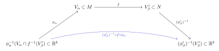

## Introduction

Welcome to the zero-zeroth chapter in [my series on information geometry](/blog/tag/information-geometry/index.html)! This is the first of two posts in the information geometry series intended to provide (some of) the requisite background in differential geometry.

This first post is intended to be a very gentle and mostly self-contained, yet sufficiently abstract, introduction to the field of differential geometry, beginning with the notion of a *smooth manifold*, then moving on to define tangent bundles, vector fields, ending with a definition of Riemannian metrics.

 For the most part, I will not delve too far into topology, differential or otherwise, and instead only introduce what is necessary to study **information geometry**. Since this is our ultimate goal, we will endeavour to keep things fairly abstract, since information geometry itself is a fairly abstract subject; specifically, it will be important to keep in mind, for this blog post and beyond, the following^[The idea here is similar to the following historical note (which I first read in [Evan Chen's Napkin](https://venhance.github.io/napkin/Napkin.pdf)) on group theory: there was a time when every group was viewed as a permutation group: this is [Cayley's Theorem](https://en.wikipedia.org/wiki/Cayley%27s_theorem). True though this may be, it is not always a useful perspective! Oftentimes it is better to think of a group as an abstract object in its own right, perhaps as a swirling blob with things colliding and floating around inside (this is sort of what my general picture of a group is).]:

A manifold is an abstract object in its own right; it does not have to be thought of as a subset of any Euclidean space, and its points need not "feel like" points in Euclidean space.

## Manifolds

In brief, a $k$-dimensional smooth manifold is any topological space that locally looks like $\RR^k$. We begin by defining what it means to "locally look like" something else:

Definition. A *$k$-dimensional smooth atlas* for a topological space $X$ is a collection of triples $(U_\alpha, V_\alpha, \phi_\alpha)$, each of which consists of: 

- an open subset $U_\alpha\subset \RR^k$

- an open subset $V_\alpha \subset X$

- a homeomorphism $\phi_\alpha: U_\alpha\to V_\alpha$,

such that $X = \bigcup_{\alpha} V_\alpha$, and all the maps 
$$\psi_{\alpha\beta} := \phi_\beta^{-1}\circ \phi_\alpha: \phi_\alpha^{-1}(V_\alpha\cap V_\beta)\to \phi_\beta^{-1}(V_\alpha\cap V_\beta)$$
are smooth maps, viewed as maps from $\RR^k\to \RR^k$. The triples $(U_\alpha, V_\alpha, \phi_\alpha)$ are called *charts*, and the $\psi_{\alpha\beta}$ are called *transition functions*.

In fact, it is not hard to see that with the restricted domains written above, the $\psi_{\alpha\beta}$ are not only smooth, they are smooth bijections whose inverses are also smooth. In other words, the $\psi_{\alpha\beta}$ are *diffeomorphisms*. 

Definition. A *smooth manifold* is a topological space $M$ with a maximal^[In brief, *maximal* means that if we take *any* chart $(U_\gamma, V_\gamma, \psi_\gamma)$ such that the new transition functions we get involving $\psi_\gamma$ are all still smooth, then $(U_\gamma, V_\gamma, \psi_\gamma)$ was already in the atlas; we cannot consistently add any new charts.] $k$-dimensional smooth atlas.

Note also that not just any topological space will do: $M$ must be both Hausdorff and second-countable, but this is unimportant for our purposes.

So, a manifold is any topological space $M$, and the atlas allows us to assign each point $p\in M$ to a point $q\in \RR^k$. There may well be multiple ways to associate  each open subset of $M$ with a subset of $\RR^k$, but smoothness of the transition functions ensures that we can interpolate between these associations smoothly. To develop an intuition for the theory, it will be useful to have several examples at our disposal. The first three are standard, and certainly "feel geometric"; the last is more abstract, but serves as the foundation for what we will study in later chapters.

Example (Open Subsets of $\RR^k$). Let $U\subset \RR^k$ be an open subset. Then $U$ is a $k$-dimensional smooth manifold: note that $U$ is a topological space, for instance by inheriting the topological structure of $\RR^k$ by way of the subspace topology. And, $U$ can be covered in a single chart: $(U, U, \id)$, where $\id$ denotes the identity map from $\RR^k$ to itself.

Example (The $1$-Sphere, $S^1$). The $1$-sphere is also known as a *circle*. Certainly it is a topological space, naturally lying inside of $\RR^2$ as the set $S^1 := \{x\in\RR^2: \norm{x}=1\}$. If you zoom in enough, a circle looks like a line, i.e., an open subset of $\RR$. One can parametrize it using four charts $\phi_i: (0, \pi)\to S^1$, $0\le i\le 3$, defined by $\phi_i(t) = (\cos(t+\tfrac{i\pi}{2}), \sin(t+\tfrac{i\pi}{2}))$: it is easy to verify that the transition functions are diffeomorphisms, so this indeed makes the $1$-sphere into a $1$-dimensional smooth manifold. One could just have easily defined $\phi_i(t) = (\cos(t+\tfrac{i\pi}{2} + \frac\pi6), \sin(t+\tfrac{i\pi}{2}+\frac\pi6))$, in which case we obtain a different *coordinate system* for $S^1$: the way we represent points on the circle is different, but the underlying manifold $S^1$ is identical.

Example (The $2$-Torus, $\TT^2$). There are many ways to construct the torus: it is often an illustrative exercise in differential topology to consider several constructions. One way is by parametrizing it, as we have done for $S^1$ above. It can be defined as the image of $h:\RR^2\to\RR^3$, 
$$(\theta,\phi) \mapsto [(2+\cos\theta)\cos\phi, (2+\cos\theta)\sin\phi, \sin\theta]$$

Another way is by using a more general schema for constructing new smooth manifolds from old ones: the Cartesian product. If $M$ and $N$ are smooth manifolds of dimension $m$ and $n$, respectively, then $M\times N$ is a smooth manifold of dimension $m+n$, by taking the product of all pairs of charts in the respective atlases of $M$ and $N$. In our case, $\TT^2$ can be realized as $\TT^2\cong S^1\times S^1$.

Example (Statistical Manifolds). Without defining terms rigorously yet, a *statistical manifold* is a manifold $M$ where every $p\in M$ is a probability distribution over some other domain $\Om$. An easy example is the space $N$ of $1$-dimensional normal distributions. The coordinate systems we define on $N$ correspond to parametrizations of families of normal distributions: one well-known parametrization is $\phi(p) = (\mu(p), \sigma(p))$, mapping a distribution to its mean and standard deviation. Another is $\phi'(p) = (\mu(p), \lambda(p))$, where $\lambda(\cdot)$ is the [precision](https://en.wikipedia.org/wiki/Precision_%28statistics%29) of a distribution.

Just like before with $S^1$, we can represent a normal distribution by multiple different parametrizations, i.e. by different coordinate systems on $N$, but these are just different ways of viewing the same point: the underlying structure of $N$ does not change. 

## The Tangent Bundle
### Smooth Maps
Rather than merely thinking of an atlas as telling you how to use Euclidean coordinates to describe points on the manifold, one can also use the atlas to tell you *which functions are smooth*^[c.f. a *topology* isn't only useful because it tells you which sets are open, but because it tells you *which functions are continuous*.].

Definition. If $M,N$ are smooth manifolds with respective maximal atlases $(U_\alpha, V_\alpha, \phi_\alpha)_{\alpha}$ and $(U'_\beta, V'_\beta, \phi'_\beta)_\beta$, and $f:M\to N$ is a continuous function, then $f$ is *smooth* if for all pairs of charts,
$$(\phi'_\beta)^{-1} \circ f \circ \phi_\alpha: \phi_\alpha^{-1}(V_\alpha \cap f^{-1}(V'_\beta)) \to (\phi'_\beta)^{-1}(V_\beta')$$
is a smooth map between open subsets of $\RR^k$:
<figure>

<figcaption>*Figure 1*. What it means for a continuous map $f:M\to N$ to be smooth. We use charts to reduce to the case of smoothness on $\RR^k$ and demand that the purple map is smooth.</figcaption>
</figure>

Now that we have a notion of smoothness, the next logical step is to define derivatives: it is always easier to study linear objects than non-linear ones.

### Derivatives
Suppose $M$ and $N$ are smooth manifolds, and $f:M\to N$ a smooth map. In order to "linearize" this relationship, we need to linearize two objects in parallel: the first is to linearize $f$ itself–this will be its derivative $df$; the second is to linearize the manifolds–this will be given by constructing the *tangent space*. Since linear maps are defined on vector spaces, this suggests that each tangent space should be a vector space. We start with the second. There are many ways to construct tangent spaces: a more rigorous treatment involves defining equivalence classes of smooth maps, and then introducing the notion of a *derivation*, which is essentially a linear map that satisfies a product rule property, and then defining the tangent space as the $\RR$-vector space of derivations at $p$.

Definition. Let $p\in M$ be any point and $(U,V,\phi)$ any chart with $p\in V$. Then the *tangent space of $M$ at $p$*, denoted $T_pM$, is the space of "velocity vectors" of curves on $M$ through $p$. Specifically, let $\gamma: (-\eps,\eps)\to M$ be a smooth function with $\gamma(0)=p$. Then $T_pM$ is the set of derivatives $\gamma'(0)$, where $\gamma'(0) = (\phi^{-1}\circ\gamma)'(0)\in\RR^k$.

We will note, but not verify, that $\gamma'(0)$ is independent of choice of chart. In short, it follows from the chain rule applied to $\psi_{\alpha\beta}$. Note also that $\phi^{-1}\circ\gamma$ is a smooth map from $\RR\to\RR^k$, per the definition of smoothness of maps between manifolds introduced in the previous section, so in particular its derivative is well-defined and has the right dimension ($T_pM$ should be a $k$-dimensional vector space if $M$ is a $k$-dimensional manifold).

Example (Tangent Space of $\RR^k$). Let us compute $T_0\RR^k$. $\RR^k$ is a $k$-dimensional smooth manifold, and can be covered in a single chart $(\RR^k,\RR^k, \id)$. Since $\id=\id^{-1}$, the set of tangent vectors at zero is simply the set of velocities of curves $\gamma$ in $\RR^k$ that pass through zero. In other words, $T_0\RR^k = \RR^k$. If $x_i$ denotes the curve $(0,\ldots, 0, t, 0, \ldots, 0)$, with $t$ in the $i$th coordinate, then the derivatives at $0$ of the $x_i$, which we denote by $\tfrac{\partial}{\partial x_i}$ form a basis of $T_0\RR^k$.

### The Tangent Bundle
Fixing a smooth map $f$, one can think of $df$ as a family of linear maps, parametrized by $x\in \RR^k$, via $x\mapsto df(x)$. The *tangent bundle* is conceptually similar: it is a family of vector spaces parametrized by points on the manifold. Visually, if we think of our manifold $M$ as living inside some Euclidean space for a moment, the tangent bundle $TM$ can be imagined as $M$ with a copy of $\RR^k$ glued to each point. Constructing it rigorously requires some care, so we take a more elementary approach and give the definition without the full construction. 

Definition. Let $M$ be a $k$-dimensional smooth manifold. Then its *tangent bundle*, denoted by $TM$, is defined as 
$$TM := \bigsqcup_{p\in M} T_pM = \{(p,v) : p\in M,\ v\in T_pM\}.$$

It also comes with a natural projection: 
$$\pi: TM \twoheadrightarrow M,\quad \pi(p,v) = p$$

It is not clear from the simple definition provided, but the point is that each open subset of $TM$ locally looks like $V\times \RR^k$, where $V\subset M$ is an open subset of $M$ covered by a chart from a maximal atlas.

Example. Let $U$ be an open subset of $\RR^k$, hence $U$ is a $k$-dimensional smooth manifold in its own right. Then $TU = U\times \RR^k$.

The projection map allows us to define vector fields on manifolds:

Definition. Let $B$ be a topological space, and $E$ any family of vector spaces parametrized by points in $B$. A *section* of $E$ is a map $\sigma: B\to E$ such that $$\pi(\sigma(x)) = x \text{ for all } x\in B.$$ 

In other words, $\sigma$ takes in a point $x$ and "picks out" a vector $v$ from the vector space at $x$, and returns the pair $(x,v)$. This should sound very similar to what we want to do with vector fields: 

Definition. If $M$ is a smooth manifold, a *vector field* on $M$ is a smooth section $X$ of $TM$.

Here, *smooth* means that the vector that $X$ returns at each point depends smoothly on the point in question: for instance, it does not return radically different vectors for two points $p, p'$ that are "near" each other on $M$. 

#### Aside
Notice, also, that the definition for section that we gave is quite general: this will be useful to define a notion of distance on $M$. Moreover, given a smooth manifold $M$ with tangent bundle $TM$, we can instead associate to each point $p\in M$ the dual vector space, and in doing so we obtain:

Definition. If $M$ is a smooth manifold, the *cotangent bundle* $T^*M$ is defined by 
$$T^*M = \bigsqcup_{p\in M} (T_pM)^* = \{(p, f): p\in M,\ f\in (T_pM)^*\}$$

And thereby recover, as an aside, the following definition, alluded to in [my blog post on the exterior derivative](/blog/posts/top_geom/only_one_derivative/one_der.html#introduction).

Definition. If $M$ is a smooth manifold, a *$1$-form* on $M$ is a smooth section $\omega$ of $T^*M$.

## Distances
We are now finally ready to leave the world of differential topology and begin studying geometric properties of smooth manifolds. Everything that follows is founded upon having a suitable notion of distance. Additional commentary can be found [here](/blog/posts/top_geom/only_one_derivative/one_der.html#riemannian-manifolds).

### Riemannian Metrics

Definition. A *Riemannian metric* $g$ is a family of symmetric positive-definite bilinear forms (inner products) on $TM$, varying smoothly in $p$.

## References
<ol>
<li> Notes on Differential Topology by <a href="https://www.utsc.utoronto.ca/people/kupers/">Alexander Kupers </a>, which do not seem to be uploaded.
</ol>