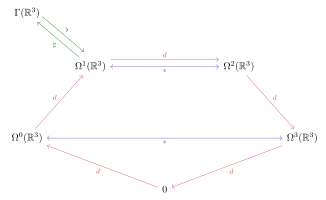
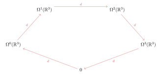
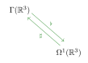
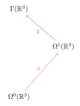
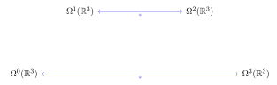
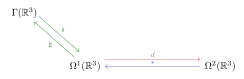
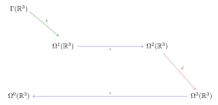
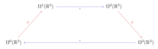

## Introduction
Those who are fortunate enough to have taken a course in multivariable calculus, or vector calculus, are likely familiar with the three "derivative-like" operators: gradient, curl, and divergence. In this writeup, I aim to demonstrate that these three are actually
all the same thing, the **exterior derivative**, just given a different name. Meta-mathematically, the goal of this writeup is to demonstrate that *every definition involved makes perfect sense*: things could not be defined in another way, even if we wanted to!

The write-up (and title!) are deeply inspired by [this excellent video](https://www.youtube.com/watch?v=ZpUvFn8Ni2I) made by Giovanni Bracchi. I first watched this video in my second year of undergrad, and understood it only on a surface level; it was not until I took a course in differential topology a couple years later that the concepts clicked.

I will assume the reader has seen some vector calculus, but more importantly, is familiar with *differential forms and the exterior
derivative*. For instance, the sentence, "A $1$-form $\om$ on a smooth manifold $M$ is a smooth section of $T^*M$" ideally makes sense to you.

The fundamental diagram that one should keep in mind during the discussion that follows is:

<figure>

<figcaption>*Figure 1*. Summary of differential geometry on $\RR^3$.</figcaption>
</figure>

and is also sourced from Giovanni's video. 

## The de Rham Complex
### Cochain Complexes

Definition. A *cochain complex* is a sequence of modules $A^0, A^1, A^2,\ldots$ all over the same fixed ring $R$, along with a sequence of $R$-module homomorphisms
$d^n: A^n \to A^{n+1}$ that satisfy $d^{n+1}\circ d^n = 0$. The maps $d^n$ are called *differentials*, or *coboundary operators*.

As the name suggests, cochain complexes are dual to *chain complexes*, which are essentially the same but with arrows reversed.

### Definition

Definition. Let $M$ be a smooth manifold. The *de Rham complex* is the cochain complex of differential forms on $M$, with differentials given by the *exterior derivative*:

<figure>
  
</figure>

In the de Rham Complex, the $\Om^k$ are $\RR$-modules (indeed, they are real vector spaces), and it can be shown, essentially by definition of $d$ and the wedge product
$\wedge$, that $d^2 = 0$^[This follows from the surprisingly oft-encountered fact that if $x\in\RR$ satisfies $x=-x$, then $x=0$.], so the de Rham complex is indeed a cochain complex.

### The de Rham Complex in $\RR^3$
In $\RR^3$, there are no non-zero differential forms of degree larger than $3$. In particular, $\Om^p\left(\RR^3\right)\cong 0$ for $p>3$, so we can write the de Rham complex in $\RR^3$ as:

<figure>
  
  <figcaption>*Figure 2*. The de Rham complex on $\RR^3$.</figcaption>
</figure>

which is the portion of *Figure 1* highlighted in red. This is the fundamental framework underlying differential topology; the de Rham complex, or more generally, de Rham cohomology, allows us to compute a powerful topological invariant of smooth manifolds, namely the de Rham cohomology groups. 

Since $d^2=0$, any $p$-form $\omega$ such that $\omega = d\eta$ for some $\left(p-1\right)$-form $\eta$ satisfies $d\omega=0$. That's a bit of a mouthful, so we give a name to such forms $\omega$:

Definition. An *exact $p$-form* is a form $\omega$ such that $\omega=d\eta$ for some $\left(p-1\right)$-form $\eta$.

One might also consider those forms whose derivative is zero:

Definition. A $p$-form $\omega$ is *closed* if $d\omega = 0$.

The aforementioned fact that $d^2=0$ gives

Proposition. Every exact form is closed.

The converse to this proposition is much more insightful: is it true that every closed form is exact? The answer depends on $M$, and the de Rham cohomology encodes *to what extent closed forms are exact*.

From the perspective of $d$, exact forms are closed for an uninteresting reason. In order to study closed forms more closely, we can ignore exact forms and define an equivalence relation $\sim$ whereby two closed $p$-forms are equivalent when they differ by an exact form:
$$\omega\sim\omega' \iff \omega = \omega' + d\eta \text{ for some $\left(p-1\right)$-form } \eta.$$
Since $d$ is linear, the closed and exact $p$-forms are both subspaces of $\Om^p\left(M\right)$, so this is just a quotient of vector spaces:
$$H^p\left(M\right) = \frac{\left\{\text{closed $p$-forms}\right\}}{\left\{\text{exact $p$-forms}\right\}} = \frac{\ker d}{\operatorname{im} d},$$
called the $p$-th *de Rham cohomology group*^[Taken together, $H^*\left(M\right) = \bigoplus_p H^p\left(M\right)$ is a graded $\RR$-algebra, with multiplication induced by the wedge product: $\left[\alpha\right]\cdot\left[\beta\right] = \left[\alpha\wedge\beta\right]$, which sends $H^p\left(M\right)\times H^q\left(M\right)\to H^{p+q}\left(M\right)$.]
 of $M$.

The takeaway is that $H^p\left(M\right) = 0$ if and only if every closed $p$-form on $M$ is exact.

The de Rham cohomology groups of a given manifold provide profound insights into its differential-topological structure. For instance:

Lemma (Poincaré). 
$$H^*\left(\RR^n\right) \cong \begin{cases}\RR &\text{if $*=0$}\\ 0 &\text{otherwise} \end{cases}$$

This result is often realized in vector calculus as a statement along the lines of: "every irrotational vector field defined on a simply-connected (or convex) domain is conservative"^[Thought of another way, this result says that the fundamental theorem of calculus holds in $\RR^n$.]. In later sections, we shall see why this statement is a consequence of the more general Poincaré Lemma written above.

But first, to fully understand *Figure 1*, and hence to truly bridge the gap from differential topology to vector calculus, we must introduce a Riemannian metric: the green maps, $\flat$ and $\sharp$, as well as the purple Hodge star operator $*$, depend on a metric.

## The Musical Isomorphism

We begin with some motivation from linear algebra.

### Linear Algebra

Let $V$ be a finite-dimensional vector space over $\RR$. It is well-known that $V$ is isomorphic to its dual space $V^*$, the finite-dimensional vector space of linear functionals on $V$. Let $e_1,\ldots, e_n$ be a basis for $V$. Then any vector $v\in V$ can be represented as a column vector $\begin{pmatrix}v_1, v_2,\ldots, v_n\end{pmatrix}^T$ in this basis, and the obvious map between $V$ and $V^*$ is given by the transpose: i.e., we represent linear functionals by row vectors. But notice that this isomorphism is not canonical: we had to first pick a basis. We can try to do something more general by defining:

Definition. A *non-degenerate bilinear form* $g:V\times V\to \RR$ is a map from $V^2$ to $\RR$ that is $\RR$-linear in each component, and satisfies $g\left(v,w\right) = 0$ for all $w$ if and only if $v=0$.

Now, suppose that our vector space $V$ comes equipped with a non-degenerate bilinear form $g$. Then $V$ is canonically isomorphic to $V^*$ via 

$$v\mapsto g\left(v,\cdot\right).$$

Note that non-degeneracy is required in order for this correspondence to be an isomorphism, or else injectivity fails!

Example. We may equip the vector space $\RR^n$ with the standard dot product, which is a non-degenerate bilinear form, and thereby obtain a natural^[Natural here is meant loosely: it means that no arbitrary choices (such as fixing a basis) are needed once an inner product is fixed.] isomorphism from $\RR^n$ to $\left(\RR^n\right)^*$.

### Riemannian Manifolds
Much of differential topology aims to extend results from linear algebra to non-linear spaces. In that spirit, let $M$ be an $n$-dimensional smooth manifold. Recall here that our goal is to define a canonical isomorphism between (smooth) vector fields and one-forms: the former is a smoothly varying choice of vector at each point, while the latter is a smoothly varying choice of covector (or linear functional) at each point. It is natural, then, to define an isomorphism between tangent spaces and their duals.

Definition. A *Riemannian metric* $g$ is a smooth family of symmetric positive-definite bilinear forms on $TM$, and hence gives an isomorphism of vector bundles between $TM$ and $T^*M$.

In other words, for each $p\in M$, the map $g|_p: T_pM\to T_p^*M$ defined by $g|_p\left(v\right) = \inprod{v}{\cdot}$ is an isomorphism of the real vector space $T_pM$ with its dual $T_p^*M$, just as above, and $g|_p\left(v\right)$ varies smoothly as we move $p$ around $M$.

Example. Let $M=\RR^3$. Then at each $p\in M$, we have $T_pM\cong \RR^3 \cong T_p^*M$, and the standard Euclidean product 
$$\inprod{\left(v_1, v_2, v_3\right)}{\left(w_1,w_2,w_3\right)} = v_1w_1 + v_2w_2 + v_3w_3$$ defines a (constant) Riemannian metric on $M$. In other words, we identify each basis vector $e_i$, for $1\le i\le 3$, with the linear functional $\inprod{e_i}{\cdot}$.

It is this Riemannian metric that we shall use for the rest of the write-up. We are now ready to define the musical isomorphism; the work we have done thus far shall soon bear fruit as we recover the gradient of a smooth function.

### The $\flat$ operator

Definition. Let $F=\left(F_1,F_2,F_3\right)\in \Gamma(\RR^3)$ be any smooth vector field. Then its *flat* is the $1$-form given by
$$\flat\left(F\right) = F^\flat := F_1dx_1 + F_2dx_2 + F_3dx_3 \in \Om^1(\RR^3)$$

### The $\sharp$ operator

Definition. Let $\alpha = f_1dx_1 + f_2dx_2 + f_3dx_3 \in \Om^1(\RR^3)$ be any $1$-form. Then its *sharp* is the vector field given by 
$$\sharp\left(\alpha\right) = \alpha^\sharp := \left(f_1, f_2, f_3\right)\in\Gamma(\RR^3)$$

The musical isomorphism is encapsulated by the following simple diagram:

<figure>

<figcaption>*Figure 3*. The musical isomorphism between vector fields on $\RR^3$ and one forms on $\RR^3$.</figcaption>
</figure>

which is the portion of *Figure 1* highlighted in green.

Where in these definitions does the Riemannian metric appear? This is a good question to ponder before moving on.

The answer is that $\inprod{\cdot}{\cdot}$ provides an identification of basis vectors $e_i$ with linear functionals $\inprod{e_i}{\cdot}$, the latter of which act identically to the $1$-form $dx_i$. Thus, the above correspondence is merely^[This definition illustrates a motif in elementary differential topology: for almost all definitions, there is *only one way to define things that makes sense*. Oftentimes, one simply does the most natural thing. In linear algebra, if you are given a vector and want to produce a linear functional, take the transpose. In differential geometry, if you are given a $1$-form and want to make a vector field, just use the same components.] saying:

- if you start with a vector field $F$, take the components of $F$ and make those the components of your one-form in the dual basis $dx_1, dx_2, dx_3$ of $\Om^1(\RR^3)$.
- if you start with a one-form $f_1dx_1+f_2dx_2+f_3dx_3$, take those components $f_i$ and make them the components of your vector field, in the standard basis $e_1, e_2, e_3$ of $\RR^3$.

## Recovering the Gradient

We now have everything we need to recover the gradient of a smooth function. Recall:

Definition. If $f:\RR^3\to\RR$ is any smooth function, then its *gradient* at a point $p$ is 
$$\nabla f\left(p\right) = \left(\partial_1 f\left(p\right), \partial_2 f\left(p\right),\partial_3f\left(p\right)\right)$$
Sometimes we also write $\grad f\left(p\right)$.

Proposition. $$\grad = \sharp d$$

Let $f$ be any smooth function, so $f\in \Om^0(\RR^3)$. By definition of exterior derivative, we have $$df = \frac{\partial f}{\partial x_1}dx_1 + \frac{\partial f}{\partial x_2}dx_2 + \frac{\partial f}{\partial x_3}dx_3 \in \Om^1(\RR^3).$$ Hence by definition of $\sharp$, we have 
$$\sharp df = \left(df\right)^\sharp = \left(\frac{\partial f}{\partial x_1}, \frac{\partial f}{\partial x_2}, \frac{\partial f}{\partial x_3}\right) = \grad\left(f\right).$$

In fact, we can sweep $\sharp$ under the rug and simply *conflate* vector fields and one-forms from the get-go, by conflating vectors and covectors in Euclidean space^[As one does.], to obtain:

Heuristic. $$\grad = d: \Om^0(\RR^3) \to \Om^1(\RR^3)$$

So the gradient is simply the exterior derivative $d$, mapping from $0$-forms to $1$-forms.

The gradient can be viewed, in the context of *Figure 1*, as the following composition of operators:
<figure>

<figcaption>*Figure 4*. The gradient operator, mapping smooth $0$-forms (functions) to vector fields on $\RR^3$.</figcaption>
</figure>

## The Hodge Star

Before we recover the curl and divergence operators, we need to introduce one final linear map: the Hodge star operator, $*$.

### Motivation
The Hodge star operator is related to the *cross product* from linear algebra. Given two vectors $u,v$, their cross product $u\times v$ lies in $\operatorname{span}\{u,v\}^\perp$, and $\left(u,v,u\times v\right)$ is a positively-oriented basis of $\RR^3$. So, given any pair of vectors, the cross product tells us their "complement" with respect to a positively-oriented basis of $\RR^3$, i.e., it answers the question, "which vector can we append to $\{u,v\}$ to get a positively-oriented basis of $\RR^3$?" It turns out that the Hodge star answers a very similar question for differential forms.

### Hodge Star Heuristic
Rather than give the formal definition of the Hodge star operator, we will instead give an informal definition inspired by the heuristic above, and reserve our commentary to the manifold $M=\RR^3$.

Informal Definition. Let $0\le p\le 3$, let $I$ be an increasing multi-index of length $p$, and let $J$ be the complementary indices. Then $*dx_I = \pm dx_J$, with the sign chosen so that $dx_I\wedge *dx_I = dx_1\wedge dx_2\wedge dx_3$. Extending this linearly gives the *Hodge star operator* $*:\Om^p\left(\RR^3\right)\to\Om^{3-p}\left(\RR^3\right).$

Diagrammatically, we have:
<figure>

<figcaption>*Figure 5*. The Hodge star operator, mapping $p$-forms to $(3-p)$-forms on $\RR^3$.</figcaption>
</figure>
This is the portion of *Figure 1* highlighted in purple.

Example. Hodge complements are easy to compute in $\RR^3$, using that the wedge product is alternating, and that forms of degree more than $3$ vanish:

- $*1 = dx_1\wedge dx_2\wedge dx_3$
- $*dx_1 = dx_2\wedge dx_3$
- $*dx_2 = dx_3\wedge dx_1 = -dx_1\wedge dx_3$
- $*dx_3 = dx_1\wedge dx_2$

Armed with the *Hodge star* in one hand and the *exterior derivative* in the other, we can now recover the curl and the divergence.

## Recovering the Curl

Definition. Let $F: \RR^3\to \RR^3$ be any smooth vector field with components $F=\left(F_1,F_2,F_3\right)$. Then its *curl*^[Speaking informally, the quantity $\curl F\cdot n$ can be interpreted as the extent to which the vector field $F$ swirls around the vector $n$.] at a point $p$ is given by

$$\curl F\left(p\right) = \left(\partial_2F_3 - \partial_3F_2, \partial_3F_1 - \partial_1F_3, \partial_1F_2 - \partial_2F_1\right)$$

Since the *curl* operator maps vector fields to vector fields, this gives us a hint for how we should decompose it into a composition of $*$s and $d$s. Moreover, the components of the curl look like a cross product, which suggests we definitely need to compute a $*$ at some point. Indeed, there is only one definition that makes sense.

Proposition. $$\curl = \sharp*d\flat.$$

Let's see why this is true by computing the right-hand-side on a vector field $F=\left(F_1,F_2,F_3\right)$. First, we have 
$$F^\flat = F_1dx_1 + F_2dx_2+F_3dx_3\in\Om^1(\RR^3)$$
Computing the exterior derivative:
$$d\left(F^\flat\right) = \left(\frac{\partial F_3}{\partial x_2} - \frac{\partial F_2}{\partial x_3}\right)dx_2\wedge dx_3 + \left(\frac{\partial F_3}{\partial x_1} - \frac{\partial F_1}{\partial x_3}\right)dx_1\wedge dx_3 + \left(\frac{\partial F_2}{\partial x_1} - \frac{\partial F_1}{\partial x_2}\right)dx_1\wedge dx_2\in\Om^2(\RR^3)$$
Applying the Hodge star operator:
$$*\left(dF^\flat\right) = \left(\frac{\partial F_3}{\partial x_2} - \frac{\partial F_2}{\partial x_3}\right)dx_1 - \left(\frac{\partial F_3}{\partial x_1} - \frac{\partial F_1}{\partial x_3}\right)dx_2 + \left(\frac{\partial F_2}{\partial x_1} - \frac{\partial F_1}{\partial x_2}\right)dx_3 \in \Om^1(\RR^3)$$
And finally, applying the $\sharp$ operator:
$$\left(*dF^\flat\right)^\sharp = \left(\frac{\partial F_3}{\partial x_2} - \frac{\partial F_2}{\partial x_3},  \frac{\partial F_1}{\partial x_3} - \frac{\partial F_3}{\partial x_1}, \frac{\partial F_2}{\partial x_1} - \frac{\partial F_1}{\partial x_2}\right) = \curl\left(F\right)\in\Gamma(\RR^3)$$

Heuristic. $$\curl = d:\Om^1(\RR^3)\to\Om^2(\RR^3)$$

The curl can be viewed, in the context of *Figure 1*, as the following composition of operators:
<figure>

<figcaption>*Figure 6*. The curl operator, mapping vector fields to vector fields on $\RR^3$.</figcaption>
</figure>

By identifying 1 and 2 forms using the Hodge star, $\curl$ takes in a vector field, which we can identify with a $1$-form, and then outputs another vector field, which we identify with a $2$-form (by first identifying with a $1$-form, and then Hodge-starring). 

## Recovering the Divergence

Definition. Let $F:\RR^3\to\RR^3$ be a smooth vector field with components $F=\left(F_1,F_2,F_3\right)$. Its *divergence*^[Speaking informally, the quantity $\div F\left(p\right)$ can be interpreted as the extent to which the vector field "emanates from $p$". If this quantity is negative, then $F$ has a tendency to "go into" $p$.] at a point $p$ is given by 
$$\div F\left(p\right) = \partial_1 F_1 + \partial_2 F_2 + \partial_3 F_3$$

This time, we are taking in a vector field, and outputting a scalar field. We can assume the previous pattern probably holds, and that $\div$ will be an analogue of $d:\Om^2(\RR^3)\to\Om^3(\RR^3)$. So, we need to start in $\Gamma(\RR^3)$, and then end up in $\Om^0(\RR^3)$. Certainly the first step must be $\flat$. We also want to incorporate $3$-forms somehow: we can get from $\Om^1(\RR^3)$ to $\Om^3(\RR^3)$ either by taking $d^2$ or by taking $d*$. Since the de Rham complex is a cochain complex, we should be reluctant to take $d^2$ unless we are committed to having the divergence of every vector field equal to zero. After landing in $\Om^3(\RR^3)$, we can just take the Hodge star back to $\Om^0(\RR^3)$, the space of smooth functions. This leads us to the formula:

Proposition. $$\div = *d*\flat.$$

As usual, we shall apply the right-hand-side to $F=\left(F_1,F_2,F_3\right)\in\Gamma(\RR^3)$. Luckily, the computation is simpler than the computation for curl! First,
$$F^\flat = F_1dx_1 + F_2dx_2+F_3dx_3\in\Om^1(\RR^3)$$
Then, we have
$$*\left(F^\flat\right) = F_1dx_2\wedge dx_3 - F_2 dx_1\wedge dx_3 + F_3dx_1\wedge dx_2 \in \Om^2(\RR^3)$$
Applying the exterior derivative:
$$d\left(*F^\flat\right) = \left(\frac{\partial F_1}{\partial x_1}+\frac{\partial F_2}{\partial x_2} + \frac{\partial F_3}{\partial x_3}\right)dx_1\wedge dx_2\wedge dx_3\in\Om^3(\RR^3)$$
And finally, applying the Hodge star again:
$$*\left(d*F^\flat\right) = \frac{\partial F_1}{\partial x_1}+\frac{\partial F_2}{\partial x_2}+\frac{\partial F_3}{\partial x_3} = \div\left(F\right)\in\Om^0(\RR^3)$$

Heuristic. $$\div = d: \Om^2(\RR^3)\to\Om^3(\RR^3)$$

In the context of *Figure 1*, the divergence can be viewed as the following composition of operators:
<figure>

<figcaption>*Figure 7*. The divergence operator, mapping vector fields to $0$-forms on $\RR^3$.</figcaption>
</figure>

This is true in the sense that we identify $2$-forms with $1$-forms, and then $1$-forms with vector fields, and identify $3$-forms with smooth functions. We have now recovered the three famous "derivative-like" operators from vector calculus as instantiations of the derivative!

As a bonus, let us recover the Laplacian operator, as well as some famous results from the vector calculus.

## Bonus Results
### Recovering the Laplacian

Definition. Let $f:\RR^3\to\RR$ be at least a $C^2$ function. Better yet, let $f\in \Om^0(\RR^3)$. Then its *Laplacian* is defined by $$\Delta f := \div\left(\grad f\right) = \partial_1^2f+\partial_2^2f+\partial_3^2f$$

One often illustratively writes $\Delta f = \nabla \cdot \left(\nabla f\right)$, even though this notation does not make much sense. Or does it?

Proposition. $$\Delta = *d*d$$

We actually don't need any computations here, because $\flat$ and $\sharp$ are mutual inverses, so
$$\Delta = \div\grad = *d*\flat\sharp d = *d*d$$
for free.

The Laplacian can be viewed, in the context of *Figure 1*, as the following composition of operators:
<figure>

<figcaption>*Figure 8*. The Laplacian operator, mapping $0$-forms to $0$-forms on $\RR^3$.</figcaption>
</figure>

### Recovering Famous Vector Calculus Facts
From the identity $d^2=0$, we can recover a couple well-known facts from vector calculus.

Corollary. $$\curl\grad = 0$$

Computing the left-hand-side gives
$$\curl\grad = \sharp*d\flat \sharp d = \sharp *d^2 = 0$$

Corollary. $$\div\curl = 0$$

Computing the left-hand-side gives
$$\div\curl = *d*\flat\sharp*d\flat = *d*^2d\flat = *d^2\flat = 0$$
Note that we used that $*^2$ is the identity on $\RR^3$, which is a non-obvious fact that can be verified by an elementary computation.

Corollary. If $F:R\to \RR^3$, where $R\subseteq \RR^3$ is convex (or simply-connected), then $F$ is irrotational if and only if $F$ is conservative.

Note that the simply-connected case requires a different argument, but the convex case follows from Poincaré's Lemma: $R$ has the same cohomology as $\RR^3$, so $H^1(R)=0$. 

Translating into the language of the exterior derivative, $\curl F = 0 \iff dF^\flat = 0$, and $F = \grad f \iff F^\flat = df$. Hence, every closed $1$-form on $R$ is exact, i.e. all irrotational vector fields are conservative. Of course, $\curl\grad=0$ by the previous corollary, so all conservative vector fields are irrotational.

## References
<ol>
<li> <a href="https://www.youtube.com/watch?v=ZpUvFn8Ni2I">The original video by Giovanni Bracchi</a>
<li> Notes on Differential Topology by <a href="https://www.utsc.utoronto.ca/people/kupers/">Alexander Kupers </a>, which do not seem to be uploaded.
</ol>